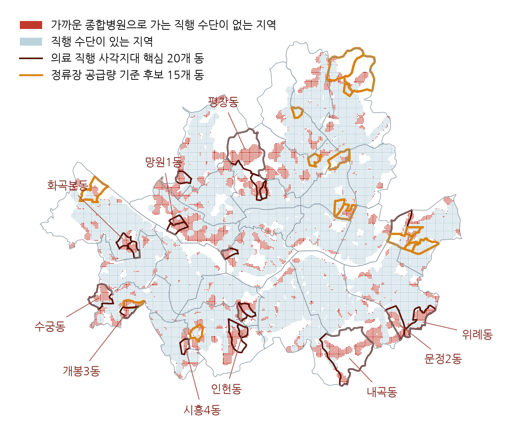
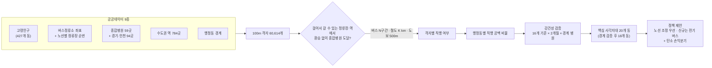
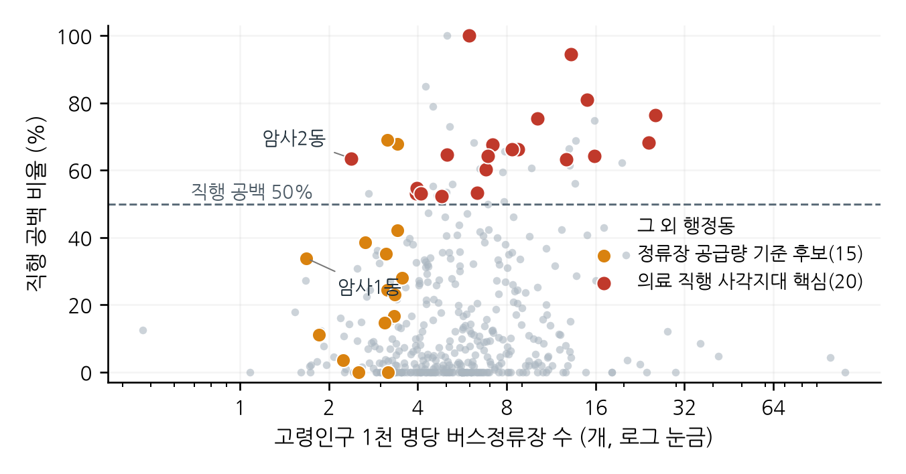
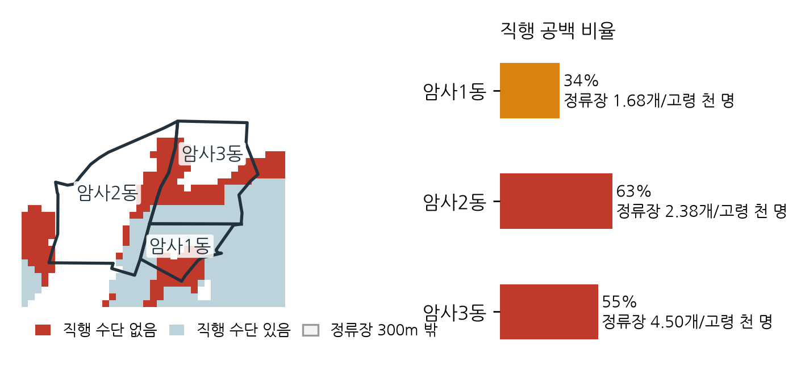
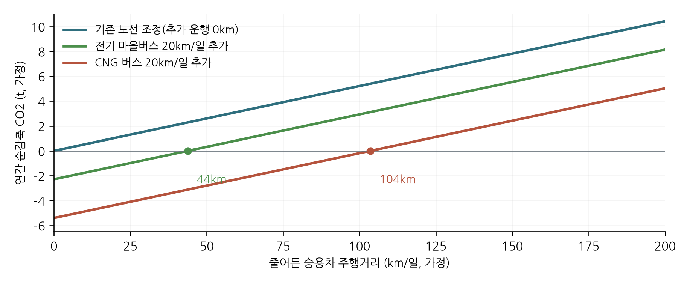

# 정류장 수로는 보이지 않는 고령자 의료 이동 사각지대

**100m 격자 단위 '환승 없는 종합병원 접근' 분석과 탄소중립 연결 방안**
한겨레×재단법인 숲과나눔 「AI와 함께하는 교통문제 해결을 위한 데이터 분석 공모전」 응모작 · 김영욱


> 서울에서 버스정류장 300m 안에 있는데도 **환승 없이 갈 수 있는 종합병원이 없는 지역이 19.5%** 입니다.
> 이런 지역의 고령인구 비율이 절반을 넘는 **핵심 사각지대 20개 동**은 기존 공급량 지표(고령인구 대비 정류장 수)로 고른 후보와 **한 곳도 겹치지 않습니다.**
> 정류장이 부족해서가 아니라, **정류장이 병원으로 이어지지 않아서** 생기는 격차입니다.

<p align="center"></p>

**[▶ GitHub에서 지도 열기: 사각지대 45개 동](maps/medical_gap_dongs.geojson)** · **[종합병원 153곳](maps/general_hospitals.geojson)** — 동을 누르면 고령인구, 직행 공백 비율, 16개 기준 범위가 표시됩니다.

---

## 한눈에 보기

| 핵심 숫자 | 의미 |
|---|---|
| **19.5%** (16개 기준 13.0~25.3%) | 정류장 300m 안 격자 중 환승 없이 가까운 종합병원에 갈 수 없는 격자 |
| **약 33만 명** (서울 고령인구의 16.8%) | 직행 공백 지역에 사는 고령인구 추정치(동 안 균등 분포 가정, 22만~45만 명) |
| **20개 동 → 18개 동 유지** | 16개 기준과 9월 자료 모두에서 직행 공백 50% 이상인 핵심 지역. 경기·인천 종합병원 94곳을 넣어도 18개 동 유지 |
| **0곳** | 핵심 지역 중 공급량 지표 후보와 겹치는 동. 직행 공백 50% 이상 45개 동의 정류장 수 중앙값(6.92개/고령 천 명)은 서울(5.20개)보다 **오히려 많음** |
| **스피어만 0.16** | 정류장 공급량과 직행 공백 비율의 순위상관. 공급량만으로는 의료 접근 격차를 설명하지 못함 |

## 무엇을 바꿔 보았나: 지표 재정의

| | 기존 공급량 지표 | 본 분석의 목적지 기반 지표 |
|---|---|---|
| 질문 | 정류장이 충분한가? | **갈아타지 않고 병원까지 갈 수 있는가?** |
| 단위 | 행정동 | **100m 격자 60,614개** (판정 대상 43,766개) |
| 경로 | 정류장 수, 정류장-노선 연결 수 | 버스(같은 노선·같은 방향 N구간) · 철도(같은 호선 K km) · 도보(500m) |
| 결과 | 후보 15개 동 | 핵심 사각지대 20개 동, 공급량 후보와 겹침 0 |



## 핵심 결과

<table><tr>
<td width="50%"><br><sub>공급량 기준 후보(주황)와 의료 직행 사각지대(빨강)는 서로 다른 동네입니다.</sub></td>
<td width="50%"><br><sub>이웃한 암사1동(34%)과 암사2동(63%): 정류장 수는 비슷해도 병원 연결은 크게 다릅니다.</sub></td>
</tr></table>

**핵심 사각지대 상위 10개 동** (공백 지역 추정 고령인구 순)

| 동 | 고령인구 | 직행 공백 | 공백 지역 추정 고령인구 | 정류장 수(개/고령 천 명) | 경계 검증 |
|---|---:|---:|---:|---:|:---:|
| 종로구 평창동 | 4,164 | 94% | 3,931 | 13.21 | 유지 |
| 구로구 수궁동 | 5,732 | 68% | 3,871 | 7.15 | 유지 |
| 마포구 망원1동 | 3,854 | 100% | 3,854 | 5.97 | 유지 |
| 강서구 화곡본동 | 6,325 | 53% | 3,353 | 3.95 | 유지 |
| 서초구 내곡동 | 3,937 | 81% | 3,188 | 14.99 | 유지 |
| 관악구 인헌동 | 4,774 | 65% | 3,089 | 5.03 | 유지 |
| 송파구 문정2동 | 4,772 | 64% | 3,066 | 6.92 | 제외(8호선으로 성남 병원 연결) |
| 송파구 위례동 | 4,707 | 63% | 2,975 | 12.75 | 제외(8호선으로 성남 병원 연결) |
| 구로구 개봉3동 | 5,293 | 55% | 2,894 | 3.97 | 유지 |
| 금천구 시흥4동 | 5,363 | 53% | 2,849 | 4.10 | 유지 |

전체 목록: `results/hospital_access_dong.csv`(427개 동), `results/hospital_access_boundary_dong.csv`(경계 검증)

## 바로 재현하기

```bash
git clone https://github.com/giverforworld/traffic-solution-for-seoul.git
cd traffic-solution-for-seoul
python -m pip install -r requirements.txt
python run_all.py
```

동봉한 원자료 스냅샷만 사용하므로 분석 중 인터넷 접속이 필요 없습니다. 마지막 단계에서 **보고서에 적힌 수치 44개를 다시 계산한 결과와 자동 대조**합니다.

```text
[ 1/10] analyze.py                     공급량 지표, 정류장-행정동 배정
[ 4/10] hospital_access.py             100m 격자 환승 없는 종합병원 접근(16개 기준 + 9월 자료)
[ 5/10] hospital_access_boundary.py    경계 민감도(경기·인천 종합병원 94곳 추가)
 ...
[10/10] check_report.py                보고서 수치 자동 대조
      보고서 수치 44/44개 항목이 결과 파일과 일치
전체 재현 완료: 43초. 대조표: results/report_number_check.md
```

대조 결과는 [`results/report_number_check.md`](results/report_number_check.md)에서 항목별로 볼 수 있습니다.

## 기준을 바꿔 보기 (약 5초, 결과 파일은 덮어쓰지 않음)

```bash
python scenario.py --n 12 --k 6        # 버스 12구간, 철도 6km
python scenario.py --walk-stop 200     # 고령자 보행거리를 300m → 200m로
python scenario.py --outside           # 경기·인천 종합병원까지 포함
python scenario.py --month 202609      # 2026년 9월 자료
```

```text
[기준] 버스 12구간 · 철도 6km · 정류장 보행 300m · 2026년 6월 · 도착지 종합병원 59곳
판정 대상 격자 43,766개 중 직행 공백 16.3%
직행 공백 지역 추정 고령인구 약 27.4만 명
직행 공백 비율 50% 이상 행정동 32곳 (고령인구 136,826명)
```

## 결과를 믿을 수 있는 이유: 검증

| 검증 | 방법 | 결과 |
|---|---|---|
| 판정 기준 민감도 | 버스 N ∈ {8, 10, 12, 15}구간 × 철도 K ∈ {4, 5, 6, 8}km, 16개 조합 | 직행 공백 13.0~25.3%. 핵심 20개 동은 **16개 기준 모두** 50% 이상 |
| 시점 민감도 | 2026년 6월·9월 정류장·승하차 자료로 각각 계산 | 핵심 20개 동 모두 9월에도 50% 이상 |
| 서울 경계 효과 | 경기·인천 상급종합·종합병원 94곳 추가(심평원 2026년 9월판) | **18개 동 유지**, 문정2동·위례동만 제외, 새 핵심 동 없음 |
| 대안 설명 배제 | 고령인구 조건을 빼고 정류장 수 하위 25%만 적용 | 핵심 20개 동 중 해당 1곳(암사2동). 차이는 선정 조건 때문이 아님 |
| 자료 결합 | 427개 동 1:1 결합, 서울·25개 구 인구 합계 일치, 정류장 11,253 → 11,236개(선착장·경계 밖 제외) | 자동 검사 통과(`results/verification.json`) |
| 병원 자료 교차 확인 | 서울시 인허가 자료와 심평원 자료의 서울 종합병원 수 비교 | 59곳으로 일치 |
| 경로 판정 점검 | 동 단위 판정의 경계 오류, 심야 N버스 포함 문제 발견 | 100m 격자 방식, 심야버스 제외로 수정 |
| 재현성 | 새로 내려받은 저장소에서 `run_all.py` 실행 | 결과 동일, 보고서 수치 44/44 일치. 원자료 해시는 `results/source_sha256.json` |

## 정책 제안: 「고령자 병원 직행 연결 시범사업」

| 단계 | 대안 | 내용 |
|:---:|---|---|
| 1 | 현장 진단 | 고령 참여자 통행일지·동행 조사로 실제 이동 시간, 환승, 보행 장애 기록 |
| 2 | 기존 노선 조정 | 시내·마을버스 경유지·정류장을 조정해 가까운 종합병원과 직행 연결(추가 운행 없음) |
| 3 | 신규 연결 | 조정이 어려운 동에 전기 마을버스 또는 수요응답형(DRT) 병원 연계 운행 |



**탄소 순감축 조건** (가정 기반 시나리오, 운행 단계 CO₂)
- 노선 조정은 추가 운행이 거의 없어 승용차 이동이 줄어든 만큼 순감축
- 하루 20km를 새로 운행하면 승용차 주행이 하루 **전기 마을버스 약 44km**, **CNG 버스 약 104km** 이상 줄어야 순감축
- → **'노선 조정 우선, 신규 운행은 전기 버스로'**

계수: 「공공부문 온실가스 목표관리 운영 등에 관한 지침」 별표 4(휘발유 2.086kgCO₂/L, 천연가스 2.160kgCO₂/Nm³, 국가 고유 전력배출계수 0.4567kgCO₂/kWh). 세부 가정은 [docs/02_carbon_method.md](docs/02_carbon_method.md).

<br clear="right">

## 데이터 (모두 공개자료, 수집일 2026-10-20)

| # | 데이터 | 제공 | 기준 시점 | 이용조건 |
|---|---|---|---|---|
| 1 | [고령자현황 통계](https://stat.eseoul.go.kr/statHtml/statHtml.do?orgId=201&tblId=DT_201004_A030002) | 서울특별시 | 2026년 2분기 | 공공누리 제1유형 |
| 2 | [버스정류소 위치정보](https://data.seoul.go.kr/dataList/OA-15067/A/1/datasetView.do) | 서울특별시 | 2026-06-02, 09-02 | 공공누리 제1유형 |
| 3 | [버스노선별 정류장별 시간대별 승하차 인원](https://data.seoul.go.kr/dataList/OA-12913/F/1/datasetView.do) | 서울특별시 | 2026년 6월, 9월 | 공공누리 제1유형 |
| 4 | [행정동 경계](https://github.com/vuski/admdongkor) | 국가데이터처 SGIS, vuski 가공 | 2026-04-01판 | CC BY 4.0 |
| 5 | [병원 인허가 정보](https://data.seoul.go.kr/dataList/OA-16479/S/1/datasetView.do) | 서울특별시 | 2026-10-20 조회 | 공공누리 제1유형 |
| 6 | [역사마스터 정보](https://data.seoul.go.kr/dataList/OA-21232/S/1/datasetView.do) | 서울특별시 | 2026-10-20 조회 | 공공누리 제1유형 |
| 7 | [버스 노선 정보](https://t-data.seoul.go.kr/dataprovide/trafficdataviewfile.do?data_id=53) | 서울특별시(T-DATA) | 2026-10-19 갱신 | 저작자표시 |
| 8 | [도시철도 환승정보](https://data.seoul.go.kr/dataList/OA-22521/F/1/datasetView.do) | 서울교통공사 | 2025-03-17판 | 공공누리 제1유형 |
| 9 | [전국 병의원 및 약국 현황](https://www.data.go.kr/data/15051059/fileData.do) | 건강보험심사평가원 | 2026년 9월판 | 공공누리 제1유형 |

번호는 분석보고서의 참고문헌 번호와 같습니다. 파일별 설명과 가공 내역은 [docs/03_data_files.md](docs/03_data_files.md). 개인정보·비공개 자료는 사용하지 않았습니다.

## AI 활용과 검증

문제 정의와 핵심 판단은 참가자가, 구현과 검토는 AI가 맡았습니다.

| 단계 | 수행 내용 | 활용 AI | 검증·결과 |
|---|---|---|---|
| ① 문제 정의 | AI가 제안한 주제 후보 중 '고령자 생활 이동'을 참가자가 선정 | Codex(주제 후보·데이터 탐색) | 자료별 이용조건 확인, 행정동 경계를 이용조건이 명시된 판본으로 교체 |
| ② 1차 분석 | 공급량 지표 설계·산출 | Codex(수집·정제·분석 코드, 시각화) | 인구 합계 보존, 427개 동 1:1 결합 자동 검증 |
| ③ 비판적 검토 | 심사위원 관점의 독립 검토를 참가자가 요청 | Claude(산출물 검토) | 철도 연결 미반영, 기준에 따라 후보가 9~24곳으로 변하는 한계를 코드로 재확인 |
| ④ 재설계 | 목적지 기반 지표로의 전환을 참가자가 결정 | Claude(지표 설계·구현) | 동 단위 판정의 경계 오류와 심야버스 포함 문제를 발견해 100m 격자 방식으로 수정 |
| ⑤ 강건성 검증 | 16개 기준과 9월 자료로 반복 계산, 경계 민감도, 전기 버스 시나리오 | Claude(민감도·재실행) | 새 환경 전체 재실행 결과 일치(원자료 생성·보간 없음) |
| ⑥ 보고서 작성 | 보고서 초안 작성, 공공기관 문체 교정, 원본 양식 편집 | Codex·Claude | 보고서 수치를 결과 파일과 자동 대조(`check_report.py`, 44/44 일치) |

주요 프롬프트(요지)는 분석보고서의 'AI 기술 활용' 항목에 수록했습니다. 별도 예측모델 학습이나 원자료 수치의 생성·보간은 하지 않았습니다. 분석 데이터는 모두 공개자료이며, 개인정보·비공개 데이터를 AI 서비스에 입력하지 않았습니다.

## 한계와 다음 단계

- 직행 판정은 정류장 순번과 직선거리 기준입니다. 실제 배차·차내 시간·보행 경사·저상버스 운행은 시범사업의 현장 진단으로 보완합니다.
- 버스 정류장 좌표는 서울시 자료만 있어, 경기도 구간 정류장에서 내리는 버스 경로는 일부만 반영됩니다(철도는 수도권 전체 역 사용).
- 공백 지역 추정 고령인구는 동 안의 고령인구가 정류장 권역에 고르게 분포한다는 가정에 따른 값입니다.
- 의원·약국 등 1차 의료기관, 실제 통행 데이터(교통카드 OD)는 후속 분석 대상입니다.
- 탄소 산정은 연비·전비·운행거리·수단 전환량에 대한 가정 시나리오이며, 실제 감축량은 사업 시행 후 측정해야 합니다.

## 저장소 구조

```text
├── run_all.py                    # 전체 재현 + 보고서 수치 자동 대조(명령 1줄)
├── check_report.py               # 보고서 수치 44개 자동 대조
├── scenario.py                   # 기준을 바꿔 즉시 재계산(결선 시연용)
├── hospital_access.py            # 핵심 지표: 100m 격자 환승 없는 종합병원 접근
├── hospital_access_boundary.py   # 경계 민감도(경기·인천 종합병원)
├── analyze.py · verify.py        # 공급량 지표와 민감도
├── evaluate_policy.py            # 사례 경로 검증, 탄소 손익분기
├── figures.py · policy_figures.py · access_figures.py · make_map.py
├── data/raw/                     # 원자료 스냅샷(출처·이용조건은 docs/03)
├── results/                      # 결과 CSV·JSON, 수치 대조표, 원자료 해시
├── figures/                      # 그림 01~10(보고서 그림 07~10)
├── maps/                         # GitHub에서 열리는 GeoJSON 지도
└── docs/                         # 1차 분석 기록, 탄소 계산, 데이터 설명, 수정 이력
```

한글 그래프 글꼴은 맑은 고딕·나눔고딕·애플 SD 고딕 Neo·Noto Sans CJK KR 순으로 찾습니다. 다른 환경에서는 `KOREAN_FONT` 환경변수에 한글 TTF 경로를 지정합니다. 원자료를 다시 받으려면 `python fetch_data.py`, `python fetch_policy_data.py`(기존 스냅샷은 덮어쓰지 않고 `data/refetched`에 저장)를 실행합니다.

**문서**: [1차 분석 기록](docs/01_initial_supply_analysis.md) · [탄소 계산 방법](docs/02_carbon_method.md) · [원자료 파일 설명](docs/03_data_files.md) · [수정 이력](docs/04_changelog.md)

원자료의 권리는 각 제공기관과 권리자에게 있으며, 출처와 이용조건을 유지해 사용해야 합니다.
